# UC Merced Land Use Classification

**Talal Aloushan · CEN454 Intelligent Systems · King Saud University · September 2024**

## 1. Overview

Land-use classification identifies the type of scene shown in an aerial image, such as a
residential area, forest, runway, or harbor. For this course project, I explored transfer
learning for **21 land-use categories**, comparing EfficientNetB0 in TensorFlow/Keras with
YOLO11n classification in PyTorch through Ultralytics.

I prepared the training and validation split, expanded the training set with image augmentation,
and compared frozen-backbone training with fine tuning. The strongest recorded model achieved
**98.45% validation accuracy**.

## 2. Results

| Approach | Input size | Best logged validation accuracy |
| --- | --- | ---: |
| EfficientNetB0 with frozen backbone | 256 × 256 | 96.07% |
| EfficientNetB0 with partial fine tuning | 256 × 256 | 97.26% |
| **YOLO11n classification** | **224 × 224** | **98.45%** |

The YOLO11 run completed 20 epochs and achieved its best top-1 accuracy at epoch 18.
Its final epoch reached 98.10%. The EfficientNet scores come from the saved notebook logs,
which include interrupted training runs. These are best logged scores on the 840-image
validation split, not results from a separate final test set.

### YOLO11 training curves

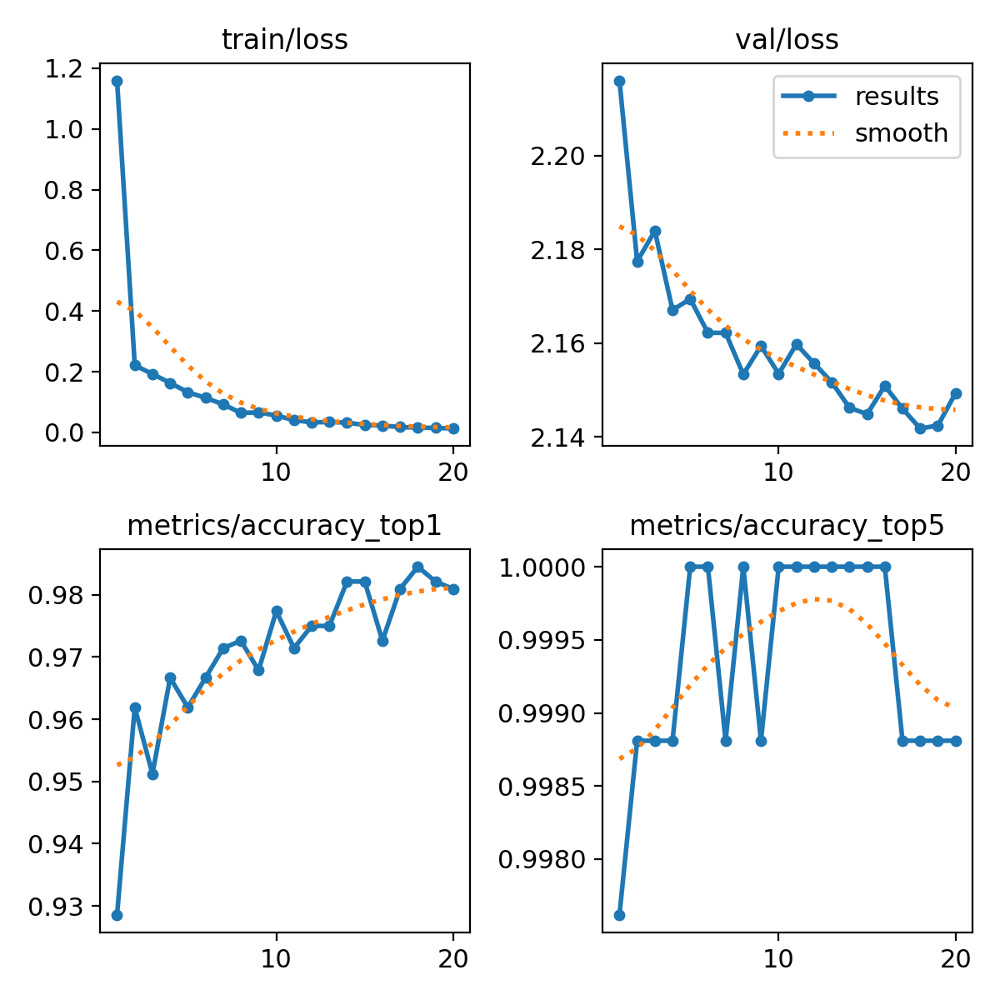

View the confusion matrix across all 21 classes

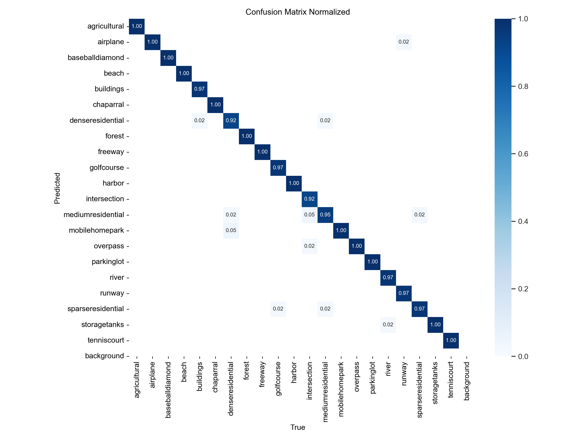

## 3. Approach

1. **Prepare and augment the data.** I split the 2,100 original images into 60% training and
   40% validation. For each training image, I generated rotated and flipped views, producing
   eight versions including the original and expanding the training set to 10,080 images.
2. **Train an EfficientNetB0 classifier.** I used an ImageNet-pretrained backbone with global
   average pooling, dropout, and a 21-class softmax head. I first trained the head with the
   backbone frozen, then fine-tuned from `block6d_se_excite` onward at a lower learning rate
   while keeping batch normalization frozen.
3. **Compare with YOLO11n-cls.** I fine-tuned the pretrained YOLO11n classification model
   for 20 epochs at an image size of 224 and batch size of 16. It delivered the highest
   recorded validation accuracy with approximately 1.56 million model parameters.

The experiments also explored deeper EfficientNet fine tuning, with CPU and memory limits
constraining that approach. The report discusses the tradeoff between accuracy, trainable
parameters, and training cost.

### Training image augmentation

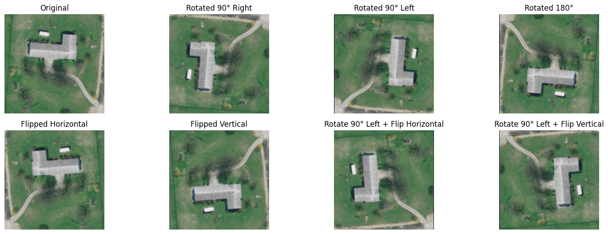

This figure is preserved from the augmentation notebook's saved output. Augmentation was
applied to the training split only.

## 4. Dataset

The [UC Merced Land Use Dataset](https://vision.ucmerced.edu/datasets/) contains **21 classes**
with **100 images per class**. The aerial scenes cover agricultural, residential, transport,
recreational, and natural environments. Most original images are 256 × 256 pixels.

| Split | Images per class | Total images |
| --- | ---: | ---: |
| Original training | 60 | 1,260 |
| Training after augmentation | 480 | 10,080 |
| Validation | 40 | 840 |

### Example scenes

| Agricultural | Airplane | Beach |
| :---: | :---: | :---: |
| 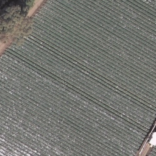 | 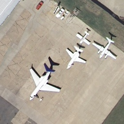 | 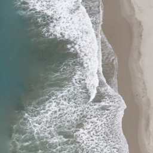 |
| **Forest** | **Freeway** | **Harbor** |
| 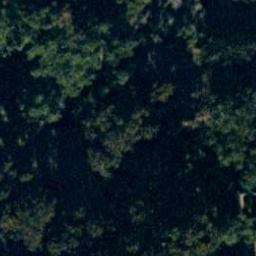 | 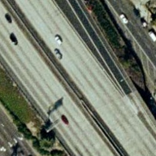 | 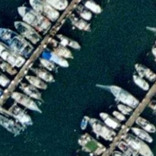 |
| **Golf course** | **Sparse residential** | **Storage tanks** |
| 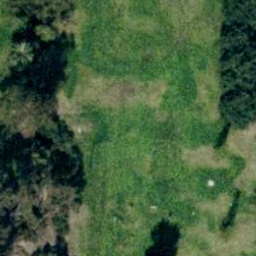 | 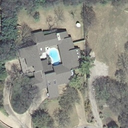 | 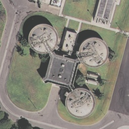 |

All 21 classes

Agricultural, airplane, baseball diamond, beach, buildings, chaparral, dense residential,
forest, freeway, golf course, harbor, intersection, medium residential, mobile home park,
overpass, parking lot, river, runway, sparse residential, storage tanks, and tennis court.

## 5. Project files

| File or folder | Contents |
| --- | --- |
| [EfficientNetB0 notebook](UCMerced-effecientnet.ipynb) | Frozen-backbone transfer learning and fine-tuning experiments |
| [Augmentation notebook](Augmentation-UCMerced.ipynb) | Image transformations and class-distribution plots |
| [YOLO11 results](yolo11/) | Trained weights, run settings, metrics, training curves, and confusion matrices |
| [Original training images](train/) | The 60% training split before augmentation |
| [Augmented training images](train_augmented/) | Eight versions of each training image |
| [Validation images](validation/) | The 40% validation split |
| [Project report](report/CEN454-UCMercedClassification.pdf) | Detailed methodology, model comparison, and findings |

The original notebooks and their saved outputs are retained. Their paths reflect the original
working directories; the augmentation notebook references both `UCMerced_LandUse` and
`UCMerced_LandUse_augmented`. No notebook code or dataset images have been changed for publication.

---

**Author:** [Talal Aloushan](https://github.com/Talal1421)

**Dataset credit:** Yi Yang and Shawn Newsam, *Bag-Of-Visual-Words and Spatial Extensions for
Land-Use Classification*, ACM GIS, 2010. [UC Merced dataset page](https://vision.ucmerced.edu/datasets/).

The YOLO checkpoints retain the upstream [Ultralytics AGPL-3.0 notice](https://github.com/ultralytics/ultralytics/blob/v8.3.31/LICENSE).
